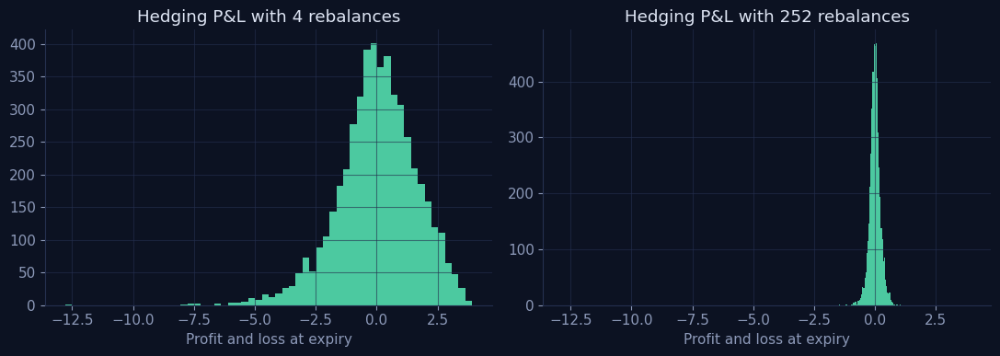

# Black-Scholes, Monte Carlo and Delta Hedging

A Python project that prices options with the Black-Scholes formula, checks the price with a Monte Carlo simulation, and then simulates selling an option and delta hedging it. I built it to understand when an options seller makes or loses money.

## The question

If you sell an option and hedge it with shares, when do you make money? How does the answer depend on how often you rebalance, and on whether the volatility you priced with matches what the stock actually does?

## How it works

- **Formula:** Black-Scholes prices for a European call and put, plus delta, gamma and vega.
- **Checks:** put-call parity, and a Monte Carlo price averaged over 200,000 simulated paths.
- **Hedging simulation:** sell one call priced at a chosen volatility, hold delta shares, rebalance at fixed intervals, and record profit and loss at expiry across 5,000 simulated paths.
- **Settings used:** stock price 100, strike 100, three months to expiry, interest rate 3%, volatility 20%.

All data is simulated.

## Results

**Does the code agree with the maths?**

- Formula call price: FILL IN. Monte Carlo call price: FILL IN, with a standard error of FILL IN.
- Put-call parity: FILL IN (the two sides matched to X decimal places).

**Experiment A: rebalancing more often reduces risk (true volatility equals priced volatility)**

**Experiment B: what if the true volatility differs from the one I priced with?**

## Limitations

- Volatility is constant, whereas real volatility changes over time.
- There are no trading costs, so more rebalancing is always better here but is not in real markets.
- Price paths have no jumps, so sudden moves are underestimated.
- Rebalancing happens at fixed intervals and is not continuous.

## Run it yourself

1. Click the Open In Colab badge at the top, or download black_scholes_hedging.ipynb and open it in Jupyter.
2. Run all cells. The settings at the top let you change the strike, expiry, interest rate and volatility.

## Possible next steps

- Solve for implied volatility from a market price using bisection.
- Add a trading cost per share and find the best rebalancing frequency.
- Let volatility change over time and test how the hedge performs.
